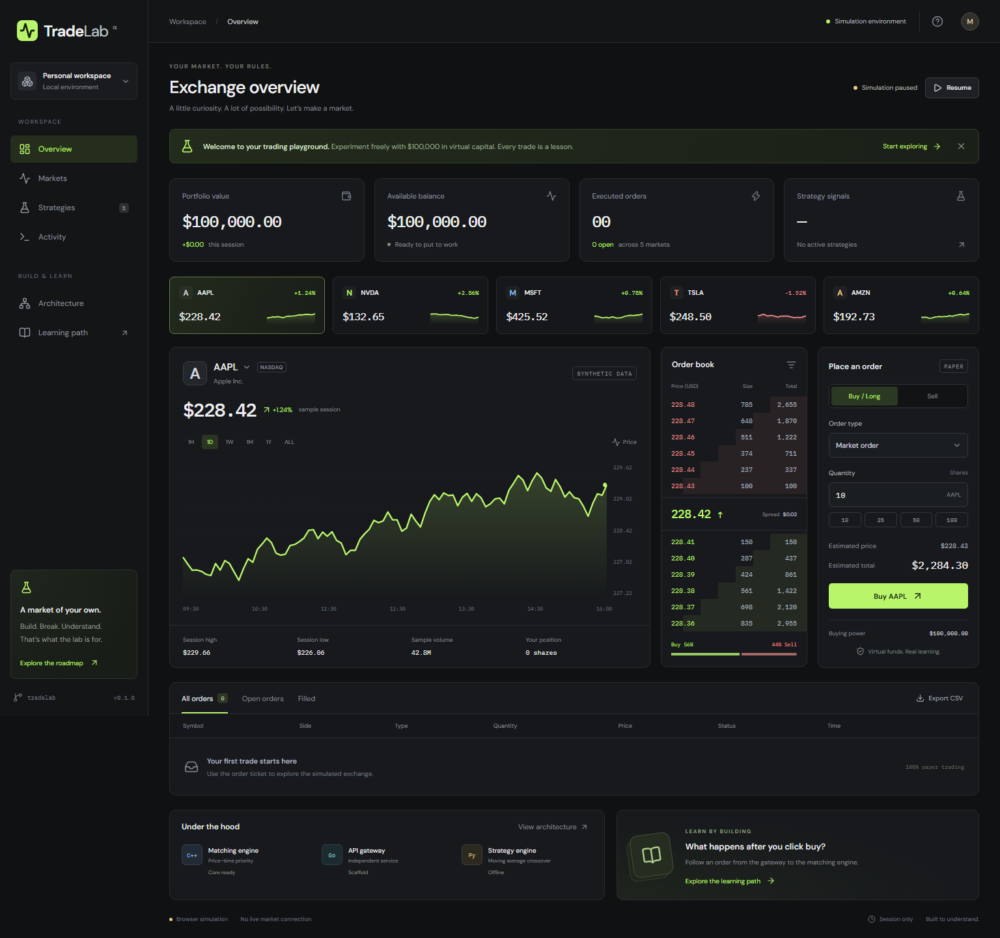

# TradeLab

**Build an exchange. Develop trading algorithms. Simulate the market.**

A learning-driven distributed quantitative trading platform, built from scratch to explore exchange infrastructure, quantitative algorithms, distributed systems, and high-performance computing.



## Start here

```sh
npm ci
npm run dev
```

Open **http://localhost:3000**. Requires Node.js 22 or newer. The dashboard starts with $100,000 in virtual funds. Choose a symbol, place a market or limit order, inspect your activity, and explore the architecture and learning path.

**New to the code? Read [the code tour](docs/CODE_TOUR.md) first.** It explains the folders, the reading order, and where to make common changes.

## Your stack

| Component               | Technology                              | Initial commit                                                          |
| ----------------------- | --------------------------------------- | ----------------------------------------------------------------------- |
| Matching engine         | C++20                                   | Price-time priority, partial fills, cancellation, Google Test           |
| API gateway             | Go                                      | Health and market endpoints; explicit 501 for unconnected order routing |
| Quantitative algorithms | Python                                  | Independent, offline moving average crossover strategy                  |
| Frontend                | Next.js, React, TypeScript              | Interactive dashboard and browser paper exchange                        |
| Real-time communication | WebSockets                              | Planned for service integration; browser currently uses a local timer   |
| Infrastructure          | Docker, Linux                           | Dockerfiles, Compose, Ubuntu CI runners                                 |
| Testing and CI/CD       | Google Test, Go testing, GitHub Actions | CI configuration for each service and container builds                  |

The C++ exchange and Python strategies stay separate. The frontend simulation makes the interface useful while the distributed services are being connected. It is **not** the C++ exchange running in the browser.

## Repository map

```text
tradelab/
├── apps/web/                  # Next.js dashboard (start here for visuals)
│   └── src/
│       ├── app/               # Page entry, global styles, metadata
│       ├── components/        # UI organized by feature
│       └── lib/               # Paper exchange logic, types, synthetic data
├── services/
│   ├── matching-engine/       # C++20 order book and Google Test suite
│   └── gateway/               # Go HTTP entry point and handlers
├── strategies/               # Independent Python algorithms and tests
├── tests/browser/            # Playwright user-flow tests
├── docs/                     # Code tour, architecture, roadmap
├── .github/workflows/ci.yml   # Checks for every part of the stack
└── compose.yaml              # Local Linux containers
```

## What works today

- Responsive trading workstation, searchable markets, illustrative charts and depth.
- Session-scoped paper account, market/limit orders, automatic limit fills, cancellation, CSV export, and simulation pause/resume.
- Standalone C++ limit order book with integer-cent prices, best-price matching, FIFO within a price level, and partial fills.
- Go health and market metadata API.
- Python strategy that emits crossover signals from a deterministic offline price stream.

## Deliberate limits

- All dashboard prices, depth, volume, and historical charts are synthetic examples, not market data. Charts are illustrative rather than a recorded execution history.
- Refreshing the page resets the paper account. Short selling, fees, persistence, and partial fills against displayed browser depth are not implemented.
- The browser fills at its synthetic bid/ask and assumes sufficient liquidity. Its depth display is illustrative. Open orders do not reserve funds; balances are checked again at execution, and unaffordable orders are cancelled.
- The strategy preview in the UI is illustrative and does not run Python or submit orders.
- The C++ engine is a library plus a demo executable. The gateway does not spawn or route to engines yet. WebSocket streaming is the next integration milestone.

## Run and test each component

| Component           | Guide                                                                    |
| ------------------- | ------------------------------------------------------------------------ |
| Dashboard           | [apps/web/README.md](apps/web/README.md)                                 |
| C++ matching engine | [services/matching-engine/README.md](services/matching-engine/README.md) |
| Go gateway          | [services/gateway/README.md](services/gateway/README.md)                 |
| Python strategies   | [strategies/README.md](strategies/README.md)                             |

Web checks, from the repository root:

```sh
npm run lint
npm run typecheck
npm test
npm run build
npx playwright install chromium
npm run test:e2e
```

Run the web and gateway in Linux containers with Docker Desktop or Docker Engine + Compose:

```sh
docker compose up --build
```

The website is on port 3000; gateway health is at `http://localhost:8080/healthz`. The services start independently; this does not connect the paper UI to the gateway.

Run the short offline demos:

```sh
docker compose --profile examples run --build --rm matching-engine
docker compose --profile examples run --build --rm strategy
```

See [architecture](docs/ARCHITECTURE.md) and [the roadmap](docs/ROADMAP.md) for what comes next.

**Resume title:** TradeLab | Distributed Quantitative Trading Platform
