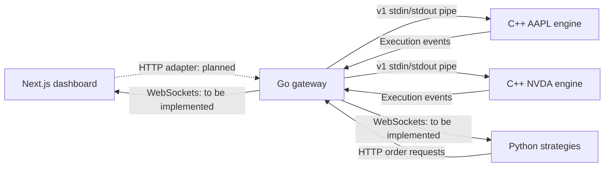

# Architecture

## Current foundation

The Go gateway now manages five independent C++ engine processes and routes market/limit orders and cancellations. A separate Python HTTP client can submit orders and receive actual execution reports. The algorithm itself remains offline. The dashboard still owns a temporary browser simulation; its cash and positions are not backend accounts.

## Target service flow

Each symbol gets an independent, sequentially owned order book. Different symbols can execute in parallel. Within a symbol, ordering is explicit and deterministic. Do not put Python strategy logic inside the C++ exchange.

## Ownership

| Layer   | Owns                                                                        | Does not own                              |
| ------- | --------------------------------------------------------------------------- | ----------------------------------------- |
| Next.js | Views, user inputs, visualization                                           | Exchange matching decisions               |
| Go      | Public API, validation, symbol routing, engine lifecycle, WebSocket fan-out | Quantitative signals                      |
| C++     | Price-time priority, resting orders, fills                                  | HTTP authentication or strategy selection |
| Python  | Signal generation and strategy configuration                                | Matching infrastructure                   |

Some target responsibilities in this table are not implemented yet. Current capabilities are listed in the root README.

## Matching semantics implemented today

- Market and limit orders, for one symbol per `OrderBook` instance.
- Highest bid and lowest ask get priority; equal prices use FIFO.
- Executions happen at the resting order's price.
- Partial fills decrement both quantities. Limit remainders rest; market remainders are immediately cancelled.
- Prices and quantities are positive signed 64-bit integers. Prices represent cents.
- Order IDs cannot be reused in the same book lifetime. Unknown cancellations return false.
- A book is single-thread owned. The separate pipe server handles transport; the core has no locks, persistence, or risk checks.
- The gateway serializes requests per process, validates reply sequences, and fails closed after a timeout or process failure. See [API.md](API.md).

## Remaining integration work

1. Add book snapshots and WebSocket subscriptions with incremental events, reconnect handling, and bounded queues.
2. Add a frontend data adapter to select either the browser simulation or the connected backend explicitly.
3. Extend the passing Python → Go → C++ integration tests to verify browser event delivery.
4. Add a strategy runner with position sizing and backend account/risk checks.

Persistence, recovery, account risk controls, latency benchmarks, and larger-scale distribution follow after this path is correct and observable.
