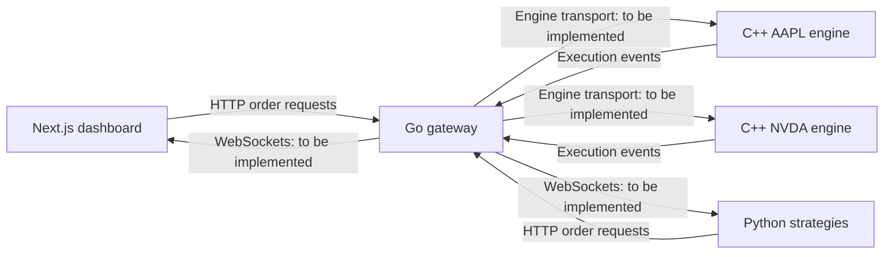

# Architecture

## Current foundation

The dashboard, C++ matching library, Go HTTP gateway, and Python algorithm run independently. The dashboard owns a temporary browser simulation so you can use and improve the UI immediately. No service integration is implied by the visual dashboard.

## Target service flow

Each symbol gets an independent, sequentially owned order book. Different symbols can execute in parallel. Within a symbol, ordering is explicit and deterministic. Do not put Python strategy logic inside the C++ exchange.

## Ownership

| Layer   | Owns                                                                        | Does not own                              |
| ------- | --------------------------------------------------------------------------- | ----------------------------------------- |
| Next.js | Views, user inputs, visualization                                           | Exchange matching decisions               |
| Go      | Public API, validation, symbol routing, engine lifecycle, WebSocket fan-out | Quantitative signals                      |
| C++     | Price-time priority, resting orders, fills                                  | HTTP authentication or strategy selection |
| Python  | Signal generation and strategy configuration                                | Matching infrastructure                   |

Some target responsibilities in this table are not implemented yet. Current capabilities are listed in the root README.

## Matching semantics implemented today

- Limit orders only, for one symbol per `OrderBook` instance.
- Highest bid and lowest ask get priority; equal prices use FIFO.
- Executions happen at the resting order's price.
- Partial fills decrement both quantities; unfilled incoming quantity rests.
- Prices and quantities are positive signed 64-bit integers. Prices represent cents.
- Order IDs cannot be reused in the same book lifetime. Unknown cancellations return false.
- A book is single-thread owned. It has no locks, persistence, risk checks, or network transport.

## Integration decisions for milestone 03

1. Define versioned order and execution contracts with IDs, symbols, sides, integer-cent prices, quantities, and sequence numbers.
2. Select a small process transport between Go and C++; preserve FIFO per symbol and return explicit failures.
3. Let Go start and monitor one matching process per symbol.
4. Replace the gateway's 501 response only after an engine can accept or reject an order.
5. Add WebSocket subscriptions, snapshots, incremental events, reconnect handling, and bounded queues.
6. Add a frontend data adapter to select either the browser simulation or the connected backend explicitly.
7. Add an end-to-end test: Python submits an order, C++ executes it, and the browser receives its event.

Persistence, recovery, account risk controls, latency benchmarks, and larger-scale distribution follow after this path is correct and observable.
